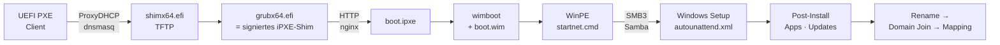

# Windows 11 Zero-Touch Deployment per PXE – mit Secure Boot und AD Domain Join

Linux-basierter PXE-Server, der **Windows 11 Pro vollautomatisch über das Netzwerk** installiert – mit aktivem **UEFI Secure Boot**, ohne Eingriff in den produktiven DHCP-Server, mit kontrollierter Treiberbereitstellung, Software-Nachinstallation und automatischem **Active-Directory-Domänenbeitritt** inklusive Namensvergabe und Gerät/Benutzer-Zuordnung.

Entstanden als betriebliches Abschlussprojekt (IHK, Fachinformatiker für Systemintegration) und anschließend produktiv weiterentwickelt. Unternehmen, Personen, Domäne, Rechnernamen und Adressen sind vollständig anonymisiert.

> **English summary:** A Linux-based PXE server that deploys Windows 11 Pro fully automatically over the network – with UEFI Secure Boot kept enabled, no changes to the production DHCP server (dnsmasq in ProxyDHCP mode), a controlled driver strategy, unattended setup, post-install automation (winget, Windows Update) and an automatic Active Directory domain join including device naming and device/user mapping. Built as a vocational final project (IT specialist for system integration) and refined in production. All company, people, domain and network details are anonymised. Documentation is in German.


---

## Ergebnis auf einen Blick

| Kennzahl | Vorher (manuell) | Nachher (PXE) |
|---|---|---|
| Aktive Adminzeit pro Client | ca. 75 Minuten | ca. 5–15 Minuten |
| Installationsstand | Momentaufnahme eines USB-Sticks | zentral gepflegt, Updates im Lauf |
| Reproduzierbarkeit | abhängig vom Bearbeiter | identischer, protokollierter Ablauf |
| Secure Boot | teils deaktiviert für Netzwerkboot | bleibt durchgehend aktiv |
| Domänenbeitritt | von Hand | automatisch inkl. Namensschema und OU |
| Amortisation | – | unter 2 Monaten (Beispielrechnung) |

## Bootkette



Der produktive DHCP-Server vergibt weiter die IP-Adressen. dnsmasq läuft im **ProxyDHCP-Modus** und liefert ausschließlich die Boot-Informationen.

## Repository-Struktur

```
win11-pxe-deployment/
├── config/
│   ├── dnsmasq.d/pxe-proxy.conf     # ProxyDHCP + TFTP, Secure-Boot-Einstieg
│   ├── nginx/pxe-boot.conf          # HTTP-Boot, auf Deployment-VLAN beschränkt
│   └── samba/smb-install.conf       # Installationsfreigabe, nur mit Anmeldung
├── http/
│   └── boot.ipxe                    # iPXE-Skript: wimboot + boot.wim
├── scripts/                         # WinPE-, Setup- und Domain-Join-Skripte
└── docs/
    ├── projektdokumentation.md      # Ausgangslage, Planung, Umsetzung, Tests, Fazit
    ├── architektur.md               # Dienste, Bootkette, Verzeichnisstruktur
    ├── domain-join.md               # Phasenmodell, Dienstkonten, Delegation
    ├── fehleranalyse.md             # Fehlerbilder, Ursachen, Lösungen
    └── betrieb.md                   # Kurz-Betriebsdokumentation
```

## Technische Highlights

**Secure Boot ohne MOK-Enrollment.** Statt eines selbst signierten Bootloaders, der auf jedem Client einen eigenen Machine Owner Key erfordert hätte, nutzt die Kette ausschließlich offiziell signierte Komponenten: Das signierte iPXE-Shim wird unter dem Dateinamen abgelegt, den `shimx64.efi` erwartet (`grubx64.efi`).

**Bewusste Entscheidung für HTTP im internen VLAN.** Ein offiziell signiertes iPXE vertraut keinem internen, selbst signierten Zertifikat. Ein Neubau mit eigenem Trust-Anchor hätte die Signatur gekostet. Abgesichert wird stattdessen über Netzsegmentierung, Samba-Authentifizierung und den weiterhin aktiven Secure Boot.

**Kontrollierte Treiberstrategie.** Der automatische Import aus `$WinPEDriver$` zog bootkritische, unpassende Treiber nach und brach das Setup ab. Ersetzt durch eine zielsystembezogene `drivers/`-Struktur getrennt nach physischer Hardware und VM.

**Windows 11 25H2 ignoriert Antwortdateien.** Die neue Setup-Engine überspringt Teile der `autounattend.xml`. Umgangen über den klassischen Setup-Pfad aus `sources\`.

**Domain Join mit Least Privilege.** Drei getrennte Phasen (Rename → Join → Mapping), dedizierte Dienstkonten mit minimalen per `dsacls` delegierten Rechten – kein Schritt nutzt Domain-Admin-Anmeldedaten.

Alle Details: [docs/projektdokumentation.md](docs/projektdokumentation.md) · Fehlerbilder: [docs/fehleranalyse.md](docs/fehleranalyse.md)

## Bewertete Alternativen

| Kriterium (je 20 %) | WDS | FOG Project | **iPXE + dnsmasq + nginx** |
|---|---|---|---|
| Lizenzkosten | 2 | 4 | **5** |
| Secure-Boot-Fähigkeit | 3 | 2 | **4** |
| Integration ohne DHCP-Änderung | 2 | 3 | **5** |
| Flexibilität | 3 | 4 | **5** |
| Heterogene Hardware | 3 | 3 | **4** |
| **Gesamt** | 2,6 | 3,2 | **4,6** |

## Lizenz

MIT – siehe [LICENSE](LICENSE). Windows, WinPE und Treiber unterliegen den Lizenzen ihrer Hersteller und sind nicht Teil dieses Repositorys.
